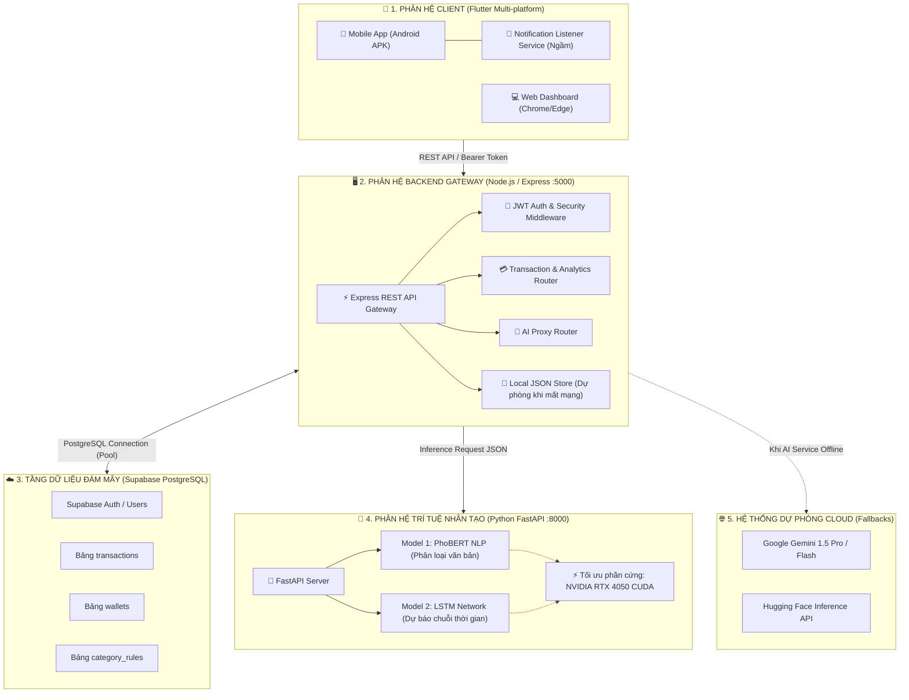

# 📘 FINWISE - TÀI LIỆU TIẾP NHẬN & PHÁT TRIỂN DỰ ÁN (PROJECT HANDOVER & DEVELOPER BIBLE)

> **Dành cho**: Bất kỳ lập trình viên, cộng tác viên, người kế thừa hoặc giảng viên/hội đồng đánh giá dự án.  
> **Mục tiêu**: Đọc xong tài liệu này, bạn có thể **hiểu toàn bộ kiến trúc**, **cài đặt môi trường trong 5 phút**, và **tiếp tục code mở rộng** dự án mà không gặp bất kỳ rào cản nào.
> 
> *Ngày cập nhật gần nhất: Tháng 11/2026*  
> *Phiên bản hệ thống: FinWise v2.0 - Production Ready*

---

## 📑 MỤC LỤC
1. [Tổng Quan Dự Án & Giá Trị Cốt Lõi](#1-tổng-quan-dự-án--giá-trị-cốt-lõi)
2. [Kiến Trúc Hệ Thống 3 Tầng (System Architecture)](#2-kiến-trúc-hệ-thống-3-tầng-system-architecture)
3. [Bản Đồ Thư Mục & Vai Trò Các File Trọng Yếu](#3-bản-đồ-thư-mục--vai-trò-các-file-trọng-yếu)
4. [Các Cơ Chế Kỹ Thuật Đặc Thù Đã Hoàn Thiện](#4-các-cơ-chế-kỹ-thuật-đặc-thù-đã-hoàn-thiện)
5. [Hướng Dẫn Cài Đặt Môi Trường Từ Con Số 0 (Zero-To-Hero)](#5-hướng-dẫn-cài-đặt-môi-trường-từ-con-số-0-zero-to-hero)
6. [Tài Khoản Thử Nghiệm & Dữ Liệu Mẫu](#6-tài-khoản-thử-nghiệm--dữ-liệu-mẫu)
7. [Quy Chuẩn Dữ Liệu, Danh Mục & Thiết Kế (Conventions)](#7-quy-chuẩn-dữ-liệu-danh-mục--thiết-kế-conventions)
8. [Xử Lý Sự Cố & Lỗi Thường Gặp (Troubleshooting Guide)](#8-xử-lý-sự-cố--lỗi-thường-gặp-troubleshooting-guide)
9. [Lộ Trình Phát Triển Tiếp Theo (Next Steps & Backlog)](#9-lộ-trình-phát-triển-tiếp-theo-next-steps--backlog)
10. [Quy Trình Đóng Gói (Build APK & Deployment)](#10-quy-trình-đóng-gói-build-apk--deployment)

---

## 🌟 1. TỔNG QUAN DỰ ÁN & GIÁ TRỊ CỐT LÕI

### 1.1. FinWise là gì?
**FinWise** là hệ sinh thái quản lý tài chính cá nhân thông minh đa nền tảng (Mobile Android, Web, Desktop), giải quyết triệt để vấn đề lớn nhất của các ứng dụng quản lý chi tiêu truyền thống: **Người dùng lười nhập liệu tay và không biết trước nguy cơ thâm hụt tài chính**.

### 1.2. Các tính năng đột phá:
* ⚡ **Tự động bắt giao dịch ngầm (Zero-touch Sync)**: Lắng nghe thông báo biến động số dư từ Vietcombank, MB Bank, Techcombank, MoMo, ZaloPay, ShopeePay... để tự tạo giao dịch tức thì mà người dùng không cần mở app gõ tay.
* 🧠 **Bộ nhớ người nhận thông minh (Smart Recipient Memory)**: Tự động ghi nhớ tài khoản / cây xăng / quán ăn quen thuộc để các lần chuyển sau tự gán danh mục chuẩn xác kể cả khi không gõ lời nhắn.
* 🤖 **Phân loại giao dịch tiếng Việt bằng AI (PhoBERT)**: Nhận diện ngôn ngữ đời thường, teencode, tiếng lóng tiền tệ (*50 cành, 2 lít, 1 củ, tiền trọ, cf, vé bus...*) và tự động phân vào 10 danh mục tài chính.
* 📈 **Dự báo dòng tiền & Cảnh báo bội chi 7 ngày tới (LSTM Time-series)**: Dùng mạng học sâu LSTM phân tích chuỗi thời gian 30 ngày của từng tài khoản để dự báo trước 7 ngày tiếp theo và cảnh báo nguy cơ vượt ngân sách.
* 📸 **Quét hóa đơn thông minh (OCR)**: Chụp hoặc tải ảnh hóa đơn từ máy ảnh/thư viện để bóc tách số tiền, cửa hàng và tự phân loại.
* 📊 **Xuất báo cáo tài chính chuyên nghiệp (.xlsx)**: Cho phép tùy biến khoảng thời gian, loại giao dịch, danh mục và lưu thẳng vào thư mục Download công khai của điện thoại kèm nút Mở & Chia sẻ qua Zalo/Drive ngay.

---

## 🏗️ 2. KIẾN TRÚC HỆ THỐNG 3 TẦNG (SYSTEM ARCHITECTURE)

Hệ thống được thiết kế theo mô hình **3-Tier Microservices**, đảm bảo tính độc lập, khả năng chịu lỗi cao và mở rộng linh hoạt:



### Chi tiết luồng dự phòng (Fault-tolerant Strategy):
1. **Phân loại AI**: `Python PhoBERT (GPU Local)` $\rightarrow$ Nếu lỗi $\rightarrow$ `PhoBERT Hugging Face` $\rightarrow$ Nếu lỗi $\rightarrow$ `Google Gemini API` $\rightarrow$ Nếu lỗi $\rightarrow$ `Rule-based Keywords Regex`. **Hệ thống không bao giờ bị dừng hoạt động.**
2. **Cơ sở dữ liệu**: `Supabase PostgreSQL (Cloud)` $\rightarrow$ Nếu mất mạng / offline $\rightarrow$ `LocalStore (data/local_*.json)`. Người dùng vẫn trải nghiệm liền mạch.

---

## 📂 3. BẢN ĐỒ THƯ MỤC & VAI TRÒ CÁC FILE TRỌNG YẾU

Toàn bộ mã nguồn nằm trong `e:\DACN2`:

```text
e:\DACN2/
│
├── START_ALL.bat                      # [CỰC KỲ QUAN TRỌNG] Script 1-click khởi chạy toàn bộ 3 phân hệ
├── STOP_ALL.bat                       # Script dừng toàn bộ hệ thống và giải phóng port
├── finwise-release.apk                # File cài đặt Android mới nhất (56.4MB)
├── admin-acc.txt                      # Tài khoản quản trị viên mặc định
│
├── 📂 finwise_mobile/                 # PHÂN HỆ 1: FLUTTER CLIENT (Android, Web, Desktop)
│   ├── pubspec.yaml                   # Khai báo dependencies (fl_chart, excel, open_filex, share_plus...)
│   └── lib/
│       ├── main.dart                  # Điểm khởi chạy app, BottomNav, lắng nghe background notification
│       ├── models/
│       │   ├── transaction_model.dart # Khối dữ liệu giao dịch thu/chi
│       │   ├── category_model.dart    # 10 danh mục chuẩn, icon và màu sắc
│       │   └── user_model.dart        # Thông tin người dùng đăng nhập
│       ├── screens/
│       │   ├── dashboard_screen.dart       # Màn hình Trang chủ (Số dư gradient, Biểu đồ tròn phân bổ chi tiêu)
│       │   ├── transactions_screen.dart    # Màn hình Sổ giao dịch (Bộ lọc ngày/tuần/tháng/loại/danh mục)
│       │   ├── add_transaction_screen.dart # Nhập giao dịch thủ công / Dán SMS / Quét OCR
│       │   ├── ai_forecast_screen.dart     # Màn hình Dự báo LSTM 7 ngày & Cảnh báo bội chi
│       │   ├── admin_dashboard_screen.dart # Bảng điều khiển Quản trị viên (Admin)
│       │   └── export_excel_dialog.dart    # Hộp thoại tùy chọn xuất Excel (.xlsx)
│       └── services/
│           ├── api_service.dart               # HTTP Client trung tâm, quản lý JWT token & kết nối Backend
│           ├── notification_sync_service.dart # [CỐT LÕI] Bắt thông báo ngầm, bóc tách VCB Ref, nhớ cây xăng
│           └── excel_export_service.dart      # [CỐT LÕI] Tạo file Excel có format đẹp & lưu vào Download
│
├── 📂 backend/                        # PHÂN HỆ 2: NODE.JS GATEWAY & API SERVER (:5000)
│   ├── server.js                      # Điểm khởi động Express server, CORS, middleware
│   ├── .env                           # File cấu hình biến môi trường (PORT, SUPABASE_URL, JWT_SECRET...)
│   ├── .env.example                   # Mẫu cấu hình tham khảo
│   ├── package.json                   # Thư viện npm (express, @supabase/supabase-js, jsonwebtoken, axios...)
│   ├── config/
│   │   ├── supabase.js                # Khởi tạo Supabase Client
│   │   └── localStore.js              # Cơ chế lưu trữ offline JSON & bộ nhớ cá nhân hóa
│   ├── routes/
│   │   ├── auth.routes.js             # API Đăng ký, Đăng nhập, Profile, Đổi mật khẩu
│   │   ├── transaction.routes.js      # API CRUD giao dịch, tự động gọi AI phân loại, học thói quen
│   │   ├── analytics.routes.js        # API Tổng hợp số dư, cơ cấu chi tiêu tháng này cho biểu đồ
│   │   ├── ai.routes.js               # API Proxy gọi sang Python AI Service hoặc Fallback Gemini/LSTM
│   │   ├── wallet.routes.js           # API Quản lý ví tiền & cập nhật số dư
│   │   └── admin.routes.js            # API Dành riêng cho quản trị viên toàn hệ thống
│   └── services/
│       ├── aiService.js               # Điều phối các tầng AI (PhoBERT Local -> Hugging Face -> Gemini)
│       ├── geminiService.js           # Tích hợp Google Gemini 1.5 Pro / Flash
│       └── ocrSpaceService.js         # Bóc tách hóa đơn bằng OCR.space API
│
└── 📂 ai_service/                     # PHÂN HỆ 3: PYTHON FASTAPI & DEEP LEARNING (:8000)
    ├── app.py                         # FastAPI Server cung cấp endpoint /classify & /forecast
    ├── requirements.txt               # Danh sách thư viện (torch, transformers, fastapi, uvicorn...)
    ├── venv/                          # Môi trường ảo Python (Đã cấu hình sẵn CUDA PyTorch)
    ├── train_phobert.py               # Script huấn luyện PhoBERT Text Classification
    ├── train_lstm.py                  # Script huấn luyện LSTM Forecaster
    ├── preprocess_data.py             # Tiền xử lý dữ liệu và tạo bộ sinh dữ liệu phong phú
    ├── dataset/                       # Dữ liệu sạch: cleaned_nlp_transactions.csv & timeseries...
    └── models/                        # Trọng số mô hình đã huấn luyện (.pth, tokenizer, scaler.pkl)
```

---

## ⚙️ 4. CÁC CƠ CHẾ KỸ THUẬT ĐẶC THÙ ĐÃ HOÀN THIỆN

### 4.1. Cơ chế bóc tách thông báo ngân hàng ngầm (SMS & App Notification Parser)
* File: [notification_sync_service.dart](file:///e:/DACN2/finwise_mobile/lib/services/notification_sync_service.dart)
* Hoạt động bằng plugin `notification_listener_service` trên Android.
* **Xử lý đặc biệt cho Vietcombank (VCB)**:
  * Tin nhắn nhận tiền có định dạng: `Số dư TK VCB 1028078349 +15,000 VND lúc... Số dư... Ref DO VAN VIET chuyen tien#SP#020097042211...`
  * Thuật toán bóc tách chuẩn xác thông tin sau từ khóa `Ref`:
    * Tách riêng **Tên người gửi**: `DO VAN VIET`
    * Tách riêng **Hành động / Lời nhắn**: `chuyen tien` (hoặc `tra tien com`)
    * Tự động loại bỏ hoàn toàn đuôi mã hệ thống `#SP#...`
    * Gán ghi chú đẹp mắt: `Nhận tiền từ DO VAN VIET`
    * Gán danh mục: `TIEN_CHUYEN_DEN` (Nhận chuyển khoản).

### 4.2. Bộ nhớ Người nhận thông minh (Smart Recipient Memory)
* Khi bạn chuyển tiền cho một đơn vị cụ thể (ví dụ: `CHI NHANH CONG TY CO PHAN THUONG MA...` - Cây xăng):
  * Lần đầu bạn chuyển 50.000đ đổ xăng $\rightarrow$ Hệ thống ghi nhận vào danh mục **`Di chuyển & Đi lại` (`DI_LAI`)**.
  * Cặp thông tin `Người nhận -> Danh mục` được lưu đồng thời vào:
    1. `SharedPreferences` trên điện thoại (`rc_mem_chinhanhcongty...`).
    2. Bảng quy tắc người dùng `local_category_rules` trên server.
  * **Lần sau chuyển tiếp cho đơn vị này**: Kể cả khi bạn **hoàn toàn không gõ lời nhắn** (để mặc định "chuyen tien"), hệ thống vẫn nhận diện đây là cây xăng quen thuộc và **tự động phân loại 100% vào `Di chuyển & Đi lại`**.

### 4.3. Dự báo dòng tiền độc lập cho từng tài khoản (Multi-User LSTM Forecaster)
* File: [ai.routes.js](file:///e:/DACN2/backend/routes/ai.routes.js#L80-L260)
* Dữ liệu chuỗi thời gian được truy vấn độc lập theo đúng `req.user.id` của người đăng nhập.
* Lấy lịch sử chi tiêu thực tế của người dùng trong 30 ngày gần nhất $\rightarrow$ Đưa qua mạng nơ-ron LSTM $\rightarrow$ Dự báo số tiền chi tiêu từng ngày trong 7 ngày tiếp theo kèm mức độ rủi ro (`AN_TOAN`, `CANH_BAO`, `NGUY_HIEM`).

### 4.4. Xuất báo cáo tài chính Excel (.xlsx) chuẩn hóa
* File: [excel_export_service.dart](file:///e:/DACN2/finwise_mobile/lib/services/excel_export_service.dart)
* Tạo báo cáo bảng tính Excel định dạng chuyên nghiệp:
  * Header thương hiệu FinWise, tên chủ tài khoản, ngày xuất báo cáo.
  * Khối tóm tắt: Tổng Thu, Tổng Chi, Số dư ròng (Net Balance).
  * Bảng dữ liệu có style màu sắc theo loại giao dịch (Thu: xanh lá, Chi: đỏ, Tổng: tím đậm).
  * **Lưu thẳng vào thư mục Tải xuống công khai**: `/storage/emulated/0/Download/FinWise_Bao_Cao_YYYYMMDD_HHMMSS.xlsx`.
  * Hiển thị modal kèm 2 nút: **"Mở File Excel Ngay"** (bằng Google Sheets / WPS / Excel) và **"Chia Sẻ File"** (qua Zalo, Gmail, Drive).

---

## 🚀 5. HƯỚNG DẪN CÀI ĐẶT MÔI TRƯỜNG TỪ CON SỐ 0 (ZERO-TO-HERO)

### 5.1. Yêu cầu phần mềm cài đặt trước (Prerequisites):
1. **Node.js**: Phiên bản 18.x hoặc 20.x trở lên.
2. **Flutter SDK**: Phiên bản 3.24.x trở lên.
3. **Python**: Phiên bản 3.10 hoặc 3.11 (có pip).
4. **Git**: Đã cài đặt và có trong PATH.
5. **Trình duyệt**: Google Chrome hoặc Microsoft Edge (để chạy Web App).

---

### 5.2. Cách khởi động nhanh nhất: 1-Click bằng `START_ALL.bat`
1. Mở thư mục gốc `e:\DACN2\` trong Windows.
2. Nhấp đúp chuột vào file **`START_ALL.bat`**.
3. Hệ thống sẽ tự động bật 3 cửa sổ:
   * **Cửa sổ 1**: `AI Service :8000`
   * **Cửa sổ 2**: `Backend Gateway :5000`
   * **Cửa sổ 3**: Hỏi bạn muốn chạy Web App (tự mở trình duyệt) hay kết nối máy thật Android qua USB/Wifi.
4. Khi muốn tắt toàn bộ hệ thống: Nhấp đúp vào **`STOP_ALL.bat`**.

---

### 5.3. Cách chạy thủ công từng phân hệ (Manual CLI)

#### Bước 1: Khởi động AI Microservice (Python FastAPI)
```powershell
cd e:\DACN2\ai_service
# Kích hoạt môi trường ảo đã cấu hình sẵn
.\venv\Scripts\activate
# Khởi động server FastAPI
python app.py
```
*Kiểm tra*: Mở trình duyệt vào `http://localhost:8000/docs` thấy Swagger UI là thành công.

#### Bước 2: Khởi động Backend Gateway (Node.js Express)
```powershell
cd e:\DACN2\backend
# Cài đặt thư viện nếu chưa có (chỉ làm lần đầu)
npm install
# Khởi động server
npm start
```
*Kiểm tra*: Server báo `[+] Server running on port 5000` và `[+] Đã kết nối Supabase Client thành công!`.

#### Bước 3: Khởi động Ứng dụng Flutter Client
* **Chạy trên Web (Chrome)**:
  ```powershell
  cd e:\DACN2\finwise_mobile
  flutter run -d chrome
  ```
* **Chạy trên Điện thoại Android (Cắm cáp USB có bật USB Debugging)**:
  ```powershell
  cd e:\DACN2\finwise_mobile
  flutter run
  ```

---

## 🔑 6. TÀI KHOẢN THỬ NGHIỆM & DỮ LIỆU MẪU

### 6.1. Tài khoản Quản trị viên (Admin):
* **Email**: `admin@finwise.com`
* **Mật khẩu**: `admin123456`
* *Quyền hạn*: Truy cập màn hình Admin (`admin_dashboard_screen.dart`), xem toàn bộ số dư hệ thống, biểu đồ chi tiêu toàn hệ thống, danh sách tất cả giao dịch và người dùng.

### 6.2. Tài khoản Người dùng trải nghiệm:
* Bạn có thể tự bấm **Đăng ký** tài khoản mới ngay trên màn hình Login của app. Dữ liệu của từng user hoàn toàn độc lập và bảo mật 100%.

---

## 🎨 7. QUY CHUẨN DỮ LIỆU, DANH MỤC & THIẾT KẾ (CONVENTIONS)

### 7.1. Bảng 10 Danh Mục Chuẩn & Mã Màu Nhận Diện:
Tất cả các màn hình (Nhập liệu, Sổ giao dịch, Biểu đồ tròn Dashboard, Báo cáo Excel) **bắt buộc** phải tuân thủ chuẩn màu đồng bộ này:

| Mã Danh Mục | Tên Danh Mục | Mã Màu Hex | Màu Nhận Diện |
| :--- | :--- | :---: | :--- |
| `AN_UONG` | Ăn uống & Cà phê | `#F59E0B` | 🟠 Vàng Cam |
| `DI_LAI` | Di chuyển & Đi lại | `#3B82F6` | 🔵 Xanh Dương |
| `MUA_SAM` | Mua sắm & Đồ dùng | `#EC4899` | 🌸 Hồng Cánh Sen |
| `HOA_DON` | Hóa đơn & Tiện ích | `#8B5CF6` | 🟣 Tím |
| `NHA_O` | Nhà ở & Tiền trọ | `#10B981` | 🟢 Xanh Lá |
| `GIAI_TRI` | Giải trí & Sở thích | `#6366F1` | 🔮 Xanh Indigo |
| `SUC_KHOE` | Sức khỏe & Y tế | `#EF4444` | 🔴 Đỏ |
| `HOC_TAP` | Học tập & Phát triển | `#14B8A6` | 💠 Ngọc Lam |
| `TIET_KIEM_DAU_TU` | Tiết kiệm & Đầu tư | `#06B6D4` | 💎 Cyan |
| `THU_NHAP` / `TIEN_CHUYEN_DEN` | Thu nhập / Nhận Chuyển Khoản | `#22C55E` / `#10B981` | ❇️ Xanh Lá Sáng |

### 7.2. Cấu trúc bảng Database (`supabase_schema.sql`):
* `users`: `id`, `email`, `password_hash`, `full_name`, `role` ('user' | 'admin'), `created_at`.
* `wallets`: `id`, `user_id`, `name`, `balance`, `is_default`.
* `categories`: `code`, `name`, `type`, `icon`, `color`.
* `transactions`: `id`, `user_id`, `wallet_id`, `category_code`, `amount`, `type` ('income' | 'expense'), `note`, `transaction_date`, `ai_predicted`, `ai_confidence`, `created_at`.

---

## 🛠️ 8. XỬ LÝ SỰ CỐ & LỖI THƯỜNG GẶP (TROUBLESHOOTING GUIDE)

### Lỗi 1: Điện thoại thật không kết nối được Backend trên máy tính
* **Nguyên nhân**: Trên điện thoại, `localhost` hoặc `127.0.0.1` trỏ về chính điện thoại chứ không phải máy tính chạy backend.
* **Cách khắc phục**:
  1. Đảm bảo điện thoại và máy tính kết nối **cùng một mạng Wi-Fi**.
  2. Mở `cmd` trên máy tính gõ `ipconfig` để lấy địa chỉ IPv4 (ví dụ `192.168.1.15`).
  3. Trên app mobile, tại màn hình Đăng nhập hoặc trong file [api_service.dart](file:///e:/DACN2/finwise_mobile/lib/services/api_service.dart#L24-L32), nhập URL: `http://192.168.1.15:5000`. Hoặc để mặc định gọi server Render Cloud 24/7 (`https://dacn2-aifinance.onrender.com`).

### Lỗi 2: Ứng dụng không tự bắt thông báo ngân hàng trên Android
* **Nguyên nhân**: Android (đặc biệt là Xiaomi MIUI/HyperOS, Samsung OneUI, Oppo ColorOS) có chế độ tiết kiệm pin tự động tắt quyền truy cập thông báo của ứng dụng chạy ngầm.
* **Cách khắc phục**:
  1. Vào **Cài đặt điện thoại** $\rightarrow$ **Ứng dụng** $\rightarrow$ **FinWise**.
  2. Bật mục **Quyền truy cập thông báo (Notification Access)**.
  3. Đặt **Tiết kiệm pin** thành **Không hạn chế (No restrictions)** và bật **Tự khởi chạy (Autostart)**.

### Lỗi 3: Lỗi cổng mạng bị chiếm dụng (`Port 5000 or 8000 already in use`)
* **Cách khắc phục**: Chỉ cần nhấp đúp vào file **`STOP_ALL.bat`** ở thư mục gốc. File này sẽ tự động tìm và kết liễu mọi tiến trình đang chiếm giữ cổng 5000 và 8000.

---

## 🗺️ 9. LỘ TRÌNH PHÁT TRIỂN TIẾP THEO (NEXT STEPS & BACKLOG)

Dành cho người tiếp tục phát triển dự án muốn mở rộng thêm tính năng để nâng cấp thành sản phẩm thương mại hoặc đề tài thạc sĩ / luận văn:

1. **OCR Offline On-Device (Tesseract / Google ML Kit)**:
   * Hiện tại: Đang dùng API đám mây OCR.space.
   * Cải tiến: Tích hợp thư viện `google_mlkit_text_recognition` trực tiếp vào Flutter để quét hóa đơn ngoại tuyến ngay trên điện thoại không cần internet.
2. **Cảnh báo Thông minh qua Telegram / Zalo Bot**:
   * Xây dựng webhook thông báo khi chi tiêu trong ngày vượt quá 80% hạn mức cảnh báo của mô hình LSTM.
3. **Mở rộng kết nối Open Banking (VietQR động)**:
   * Tích hợp sinh mã QR thanh toán động cho các hóa đơn sinh hoạt nhóm hoặc chia tiền phòng trọ (Splitwise clone).

---

## 📦 10. QUY TRÌNH ĐÓNG GÓI (BUILD APK & DEPLOYMENT)

### 10.1. Build bản phát hành Android APK:
Khi có chỉnh sửa code Flutter và muốn đóng gói bản APK mới nhất gửi cho người dùng hoặc giảng viên:
```powershell
cd e:\DACN2\finwise_mobile
flutter build apk --release
```
* File APK đầu ra nằm tại: `finwise_mobile\build\app\outputs\flutter-apk\app-release.apk`.
* Copy đè ra thư mục gốc để người dùng tải nhanh:
```powershell
copy finwise_mobile\build\app\outputs\flutter-apk\app-release.apk e:\DACN2\finwise-release.apk
```

### 10.2. Deploy Backend lên Cloud (Render / Railway):
* Backend Node.js đã sẵn sàng triển khai trên [Render](https://render.com) hoặc Railway.
* Build command: `npm install`
* Start command: `node server.js`
* Đặt các biến môi trường từ file `backend/.env` lên Dashboard của Render/Railway.

---

> 🎉 **LỜI KẾT**:  
> Dự án FinWise đã được cấu hình với độ hoàn thiện cực kỳ cao, mã nguồn mạch lạc và có đầy đủ cơ chế dự phòng an toàn. Chúc bạn tiếp nhận và phát triển dự án thành công rực rỡ! Nếu có bất kỳ thắc mắc nào, hãy tra cứu các file code mẫu được liên kết chi tiết trong tài liệu này.
