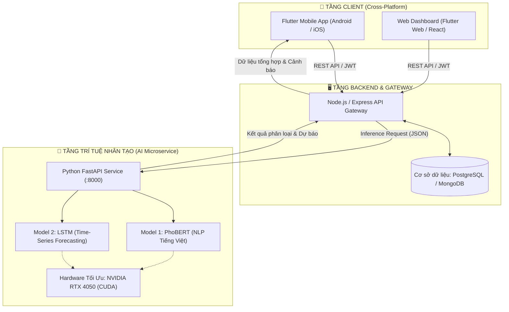

# 🌟 ĐỒ ÁN CHUYÊN NGÀNH 2 (ĐACN2)
## HỆ SINH THÁI QUẢN LÝ TÀI CHÍNH CÁ NHÂN ĐA NỀN TẢNG TÍCH HỢP AI (FinWise)

> **Tài liệu tổng quan dự án**: Ghi lại toàn bộ kiến trúc hệ thống, các phân hệ đã thực hiện, kết quả dữ liệu, mô hình AI và lộ trình phát triển. Dành cho người tiếp nhận dự án, cộng tác viên hoặc giảng viên chấm điểm đồ án.

---

## 📌 1. TỔNG QUAN KIẾN TRÚC DỰ ÁN (SYSTEM ARCHITECTURE)

Dự án được xây dựng theo mô hình **Kiến trúc hướng dịch vụ 3 tầng (3-Tier Microservice Architecture)**, tối ưu cho việc vận hành đa nền tảng và tích hợp trí tuệ nhân tạo:



### Chi tiết 3 phân hệ:
1. **Client Đa nền tảng (Flutter)**: Giao diện người dùng mượt mà trên Android và iOS. Cho phép nhập giao dịch nhanh, xem biểu đồ dòng tiền trực quan, nhận cảnh báo tài chính thông minh.
2. **Backend API Gateway (Node.js / Express)**: Quản lý người dùng, xác thực token (JWT), phân quyền, quản lý ví và hạn mức chi tiêu, đồng bộ cơ sở dữ liệu.
3. **AI Microservice (Python FastAPI - Thư mục `ai_service/`)**: Độc lập, hiệu năng cao, chuyên trách xử lý các tác vụ AI phức tạp bằng Deep Learning trên card đồ họa rời.

---

## 📁 2. CẤU TRÚC THƯ MỤC DỰ ÁN

```text
e:\DACN2\
│
├── README.md                          # [FILE NÀY] Tài liệu tổng quan toàn bộ dự án
│
├── dataset/                           # Dữ liệu nguồn thực tế tải về từ Kaggle & Hugging Face
│   ├── banking77_train.csv            # 10.000 mẫu Banking77 (Huấn luyện)
│   ├── banking77_test.csv             # 3.080 mẫu Banking77 (Kiểm thử)
│   ├── kaggle_vn_cashless_2026.csv    # Dữ liệu giao dịch không tiền mặt Việt Nam
│   ├── Daily Household Transactions.csv # Dữ liệu chi tiêu hộ gia đình
│   └── personal_transactions_ready.xlsx # Bảng dữ liệu sao kê cá nhân
│
└── ai_service/                        # PHÂN HỆ AI (ĐÃ HOÀN THIỆN TOÀN BỘ MÃ NGUỒN)
    ├── README.md                      # Hướng dẫn chi tiết chạy phân hệ AI
    ├── requirements.txt               # Danh sách thư viện Python (PyTorch CUDA, Transformers...)
    ├── venv/                          # Môi trường ảo Python (Đã cài đặt sẵn CUDA RTX 4050)
    │
    ├── dataset/                       # Dữ liệu sạch đã qua tiền xử lý chuẩn hóa
    │   ├── cleaned_nlp_transactions.csv        # 12.540 dòng văn bản cho PhoBERT
    │   └── cleaned_timeseries_daily_expense.csv # 1.494 ngày chi tiêu cho LSTM
    │
    ├── download_datasets.py           # Script tải tự động dataset từ Hugging Face & Kaggle
    ├── generate_datasets.py           # Script sinh dữ liệu phong phú ngữ cảnh Việt Nam
    ├── preprocess_data.py             # Script làm sạch, gộp dữ liệu & chuẩn hóa nhãn
    │
    ├── train_phobert.py               # Huấn luyện Model 1 (PhoBERT NLP) + Xuất biểu đồ báo cáo
    ├── train_lstm.py                  # Huấn luyện Model 2 (LSTM Forecaster) + Xuất biểu đồ so sánh
    └── app.py                         # FastAPI Server cung cấp REST API cho Client & Backend
```

---

## 🎯 3. NHỮNG GÌ ĐÃ HOÀN THÀNH (CHI TIẾT PHÂN HỆ AI)

Phân hệ **AI Microservice** (`ai_service/`) đã được thiết lập hoàn chỉnh từ dữ liệu, pipeline tiền xử lý, thuật toán học sâu cho tới API phục vụ:

### 3.1. Thu thập & Tiền xử lý dữ liệu (Data Pipeline)
* Đã lọc và tiền xử lý kết hợp từ **4 nguồn dữ liệu thực tế** (Kaggle & Banking77).
* Xây dựng bộ sinh dữ liệu mở rộng cho **4 trường hợp thực tế tiếng Việt**:
  * **TH1 - Biến động số dư & SMS sao kê**: Mẫu tin nhắn Vietcombank, Techcombank, MB Bank, MoMo, VNPay, ZaloPay...
  * **TH2 - Ngôn ngữ đời thường & Teencode**: Tiếng lóng chỉ tiền tệ (*cành, lít, củ, k, tr, lít rưỡi...*), từ viết tắt (*cf, ts, đt, trọ...*).
  * **TH3 - Chuỗi thương hiệu & Cửa hàng tại Việt Nam**: Shopee, TikTok Shop, Grab, Xanh SM, Winmart, Circle K, Highlands, Phúc Long, Long Châu, Pharmacity...
  * **TH4 - Khoản chi sinh hoạt đặc thù**: Học phí tín chỉ, tiền nhà trọ, tiền rác, vé xe buýt, phí quản lý chung cư, đóng quỹ...
* **Kết quả đầu ra dữ liệu**:
  * `cleaned_nlp_transactions.csv`: **12.540 dòng mẫu**, cân bằng chính xác giữa **10 danh mục tài chính**.
  * `cleaned_timeseries_daily_expense.csv`: **1.494 mốc ngày** chi tiêu thực tế liên tục từ 2015 đến 2026.

### 3.2. 10 Danh mục chuẩn phân loại giao dịch (Standard Categories)
| STT | Mã danh mục | Tên danh mục hiển thị | Ví dụ thực tế |
| :---: | :--- | :--- | :--- |
| 1 | `AN_UONG` | Ăn uống & Cà phê | Ăn phở bò 45k, cafe Highland, buffet lẩu haidilao 500k |
| 2 | `DI_LAI` | Di chuyển & Đi lại | Đổ xăng ron 95 70k, book GrabBike đi học, nạp VETC cao tốc |
| 3 | `MUA_SAM` | Mua sắm & Đồ dùng | Áo phông Uniqlo, săn sale Shopee 11.11, mua kem chống nắng |
| 4 | `HOA_DON` | Hóa đơn & Tiện ích | Tiền điện sinh hoạt EVN, internet Viettel, gia hạn Netflix |
| 5 | `NHA_O` | Nhà ở & Tiền trọ | Chuyển khoản tiền phòng trọ tháng 10, phí dịch vụ chung cư |
| 6 | `GIAI_TRI` | Giải trí & Sở thích | Vé xem phim CGV, nạp thẻ Garena Liên Quân, mua game Steam |
| 7 | `SUC_KHOE` | Sức khỏe & Y tế | Mua thuốc tại Long Châu, khám bệnh viện DHYD, thẻ tập gym |
| 8 | `HOC_TAP` | Học tập & Phát triển | Nộp học phí tín chỉ, mua sách Fahasa, thi chứng chỉ IELTS |
| 9 | `TIET_KIEM_DAU_TU` | Tiết kiệm & Đầu tư | Mở sổ tiết kiệm online 6 tháng, nạp tài khoản chứng khoán VPS |
| 10 | `THU_NHAP` | Thu nhập & Lương | Nhận lương công ty ABC, thưởng KPI, ba mẹ gửi sinh hoạt phí |

### 3.3. Kịch bản Huấn luyện Model (Deep Learning Models)
* **Model 1: `train_phobert.py` (NLP PhoBERT)**
  * Kiến trúc nền: `vinai/phobert-base-v2` chuyển giao học tập (Transfer Learning).
  * Tối ưu hóa: Huấn luyện trên **GPU NVIDIA RTX 4050 6GB (CUDA)**, sử dụng Mixed Precision (FP16) và AdamW với Linear Warmup.
  * Tự động sinh file đánh giá: Bảng Classification Report (Precision, Recall, F1-Score), ma trận nhầm lẫn `phobert_confusion_matrix.png`, đồ thị huấn luyện `phobert_training_metrics.png`.
* **Model 2: `train_lstm.py` (Time-Series Forecaster)**
  * Kiến trúc: Mạng nơ-ron hồi quy LSTM (2 lớp LSTM, Dropout 0.2, Hidden size 64) kết hợp các lớp Fully-Connected Dense.
  * Phương pháp: Cửa sổ trượt 30 ngày (Sliding Window) $\rightarrow$ Dự báo chuỗi 7 ngày tương lai.
  * Chuẩn hóa: `MinMaxScaler` đưa về đoạn [0, 1] và lưu cấu hình sang `scaler.pkl`.
  * Tự động sinh báo cáo sai số: Tính toán chỉ số **MAE** (Mean Absolute Error) & **RMSE** (Root Mean Squared Error), vẽ đồ thị đối chiếu `lstm_forecast_comparison.png`.

### 3.4. Giao diện REST API (`app.py` - FastAPI)
Cung cấp sẵn 3 API endpoints phục vụ cho ứng dụng Flutter và Backend Node.js:
* `GET /health`: Trả về trạng thái server, loại thiết bị GPU (`NVIDIA GeForce RTX 4050 Laptop GPU`) và trạng thái sẵn sàng của 2 mô hình.
* `POST /api/v1/ai/classify`:
  * **Input**: `{"text": "Ăn bún bò huế 45k"}`
  * **Output**: `{"category_code": "AN_UONG", "category_name": "Ăn uống & Cà phê", "confidence": 0.985}`
* `POST /api/v1/ai/forecast`:
  * **Input**: Mảng 30 số thực thể hiện chi tiêu 30 ngày gần nhất `{"daily_expenses": [150000, 200000, ...]}`
  * **Output**: Mảng dự báo 7 ngày `predicted_next_7_days`, tổng dự chi, chi tiêu trung bình ngày và cảnh báo rủi ro chi tiêu (`AN_TOAN`, `TRUNG_BINH`, `CAO`).

---

## ⚡ 4. HƯỚNG DẪN CHẠY DỰ ÁN (QUICK START GUIDE)

### 🌟 CÁCH 1: KHỞI CHẠY 1-CLICK TỰ ĐỘNG (KHUYÊN DÙNG)
Bạn chỉ cần mở thư mục `e:\DACN2\` trong File Explorer của Windows:
* 👉 **Nhấp đúp chuột vào file: `START_ALL.bat`**
* File script sẽ tự động mở 3 cửa sổ console chạy độc lập:
  1. `AI Service` (FastAPI cổng `:8000`)
  2. `Backend Gateway` (Node.js cổng `:5000`)
  3. `Flutter Web App` (Tự động mở trình duyệt Chrome)
* 👉 Khi muốn dừng toàn bộ và giải phóng các cổng: **Nhấp đúp chuột vào file: `STOP_ALL.bat`**.

---

### 💻 CÁCH 2: CHẠY THỦ CÔNG TỪNG PHÂN HỆ
Nếu muốn chạy từng phần trong Terminal:

#### Bước 1: Khởi chạy AI Service (FastAPI)
```powershell
cd e:\DACN2\ai_service
.\venv\Scripts\python.exe app.py
```

#### Bước 2: Khởi chạy Backend Gateway (Node.js)
```powershell
cd e:\DACN2\backend
npm start
```

#### Bước 3: Khởi chạy Ứng dụng Flutter
```powershell
cd e:\DACN2\finwise_mobile
flutter run -d chrome
```

---


## 🗺️ 5. LỘ TRÌNH PHÁT TRIỂN TIẾP THEO (ROADMAP)

- [x] Thu thập và xây dựng bộ dữ liệu tài chính tiếng Việt (12.540 dòng NLP, 1.494 ngày Time-series).
- [x] Xây dựng Pipeline huấn luyện PhoBERT (Text Classification) và LSTM (Chuỗi thời gian).
- [x] Xây dựng REST API Microservice (FastAPI + Swagger docs + CORS).
- [x] Chạy huấn luyện lưu trọng số mô hình vào thư mục `models/` (PhoBERT 96.54% Accuracy, LSTM MAE 5.49M) và xuất biểu đồ vào `reports/`.
- [x] Khởi tạo thư mục Backend Gateway (`backend/` - Node.js/Express & Supabase):
  - Hệ thống xác thực người dùng (Register, Login với JWT).
  - Tích hợp kết nối cơ sở dữ liệu Supabase (PostgreSQL) với schema đầy đủ (`supabase_schema.sql`).
  - Quản lý ví tiền, danh mục chuẩn, giao dịch thu chi tự động gọi AI phân loại.
  - Tích hợp cổng AI Gateway trung gian kết nối trực tiếp sang Python AI Service (:8000).
- [x] Khởi tạo thư mục Client Flutter đa nền tảng (`finwise_mobile/`) thiết kế giao diện UI:
  - Màn hình Home Dashboard (Thẻ số dư gradient, Biểu đồ tròn phân bổ chi tiêu fl_chart, Lịch sử giao dịch).
  - Màn hình Nhập giao dịch thông minh tích hợp nút "✨ AI Tự Phân Loại" (PhoBERT).
  - Màn hình Dự báo tài chính & Cảnh báo vượt ngân sách 7 ngày tới (LSTM LineChart).
  - Tương thích đa nền tảng (Android, Web, Windows Desktop).

---

> **Tác giả / Nhóm đề tài**: Đề tài Quản lý Tài chính Cá nhân Tích hợp AI (ĐACN2).  
> **Phần cứng thực nghiệm**: AMD Ryzen 7 + NVIDIA GeForce RTX 4050 Laptop GPU (CUDA 12.1).
